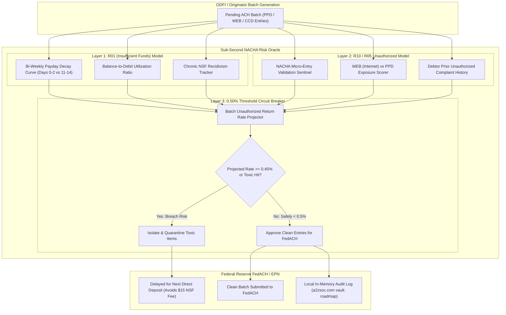
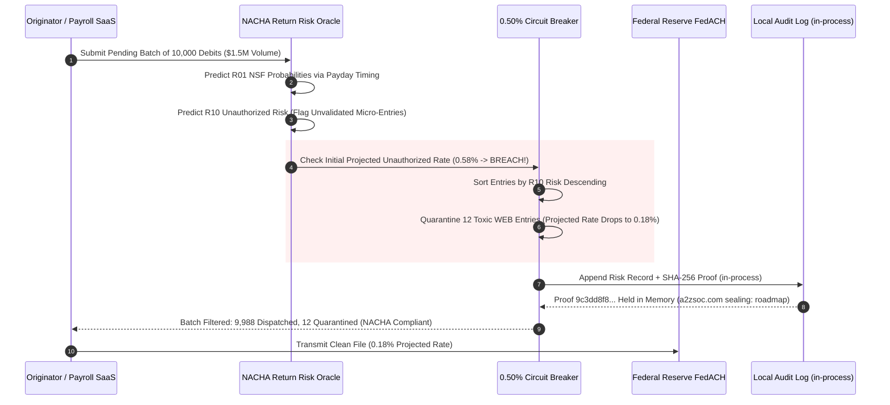

# NACHA-Return-Risk-Oracle

**Sub-Second ACH Return (R01/R10) Predictor & Micro-Deposit Risk Oracle (NACHA 0.50% Threshold Circuit Breaker)**

[](https://www.python.org/downloads/)
[](https://www.nacha.org/)
[-red.svg)]()
[]()
[-success.svg)]()
[]()
[](LICENSE)

---

## Executive Summary: Preventing Existential NACHA Origination Revocations

Originating Depository Financial Institutions (ODFIs) and ACH Originators operate under existential return rate caps codified in the **NACHA Operating Rules & Risk Management Framework**:

1. **The 0.50% Unauthorized Return Rate Cliff**:  
   If an originator's unauthorized return rate (codes **R05, R07, R10, R29, R51**) crosses **0.50%** (5 per 1,000 originations), NACHA initiates formal inquiries, levies severe financial penalties, and mandates originator de-banking.
2. **The 2-to-3 Business Day Blind Spot**:  
   Traditional originators submit ACH batch files blindly over FedACH or EPN and discover returned entries days later—after an unauthorized scam wave has already blown past the 0.50% threshold.
3. **The Micro-Entry Account Validation Mandate**:  
   NACHA rules explicitly require originators to conduct risk-based monitoring on micro-entries used for account validation to prevent credit-push testing and unauthorized ACH debits.

`nacha-return-risk-oracle` is a zero-dependency, sub-second pre-origination engine that predicts **R01 (Insufficient Funds)** and **R10 (Customer Advises Unauthorized)** returns *before* batch transmission, dynamically quarantining toxic entries to keep originators below the 0.50% threshold, and computing a local SHA-256 integrity proof of each batch assessment. Remote sealing of those proofs to the **[a2zsoc.com](https://a2zsoc.com)** Sovereign Evidence Vault is a roadmap item, not yet implemented: the current build records each assessment only in an in-process `audit_log` list and makes no network call.

---

## System Architecture



---

## Batch Governance Workflow: Guarding the 0.50% Ceiling



---

## Core Capabilities

| Capability | NACHA Operating Rule | Risk Mitigation Guarantee |
|:---|:---|:---|
| **0.50% Threshold Circuit Breaker** | Risk Management Framework | Dynamically isolates toxic items to keep unauthorized return rates safely below 0.50% |
| **R01 NSF Predictive Timing** | Direct Deposit Timing Rules | Predicts balance depletion on days 11-14 of payroll cycle, preventing $15 ODFI return fees |
| **Micro-Entry Rule Sentinel** | Micro-Entries Rule | Identifies first-time debit pulls without completed micro-deposit validation |
| **WEB Debit Risk Scorer** | WEB SEC Code Guidelines | Flags anomalous high-value internet-initiated debit pulls |
| **Evidence Sealing** | SHA-256 content hash | Computes a per-batch SHA-256 integrity proof and appends it to an in-process audit log (persistent/remote sealing to `a2zsoc.com` is roadmap) |

---

## Quickstart & CLI

```bash
# Clone the repository
git clone https://github.com/AAH20/nacha-return-risk-oracle.git
cd nacha-return-risk-oracle

# Run the complete 4-scenario NACHA batch risk demonstration
python3 -m nacha_return_risk_oracle.cli demo
```

---

## Automated Test Suite

`nacha-return-risk-oracle` ships a standard library `unittest` suite:

```bash
python3 -m unittest discover -s tests
```

Output:
```
.......
----------------------------------------------------------------------
Ran 7 tests in 0.000s

OK
```

---

## License

Apache License 2.0. See [LICENSE](LICENSE) for details.
